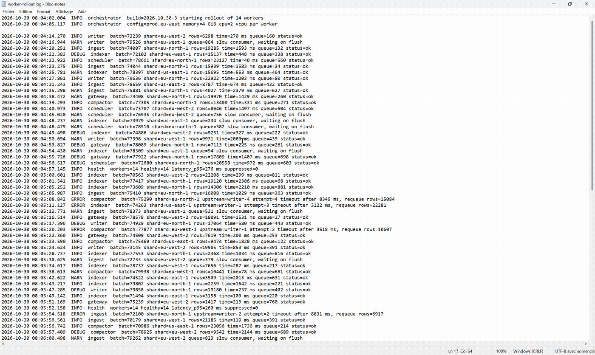
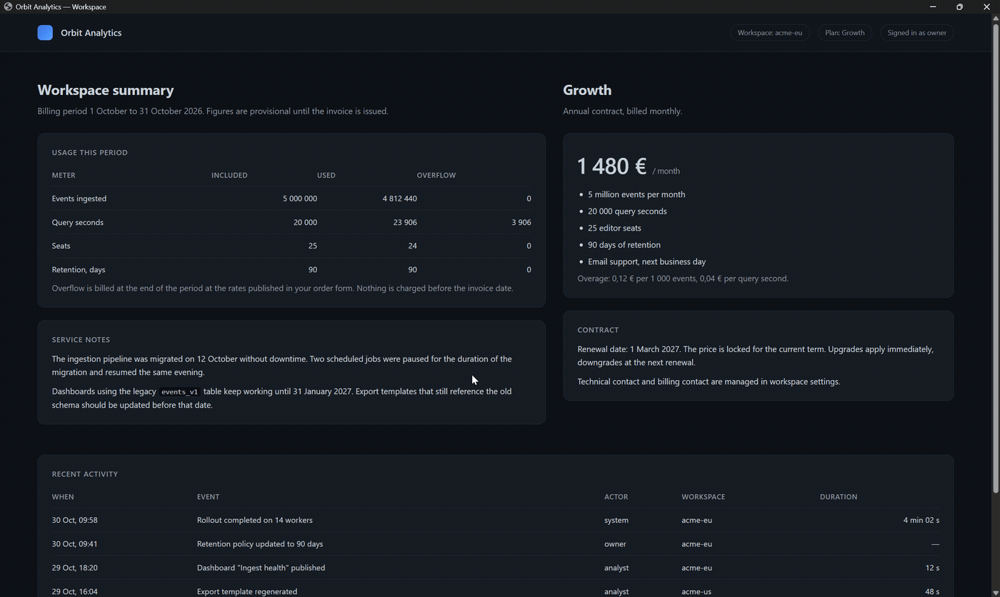

<p align="center">
  
</p>

<h1 align="center">TextReveal</h1>

<p align="center">
  <b>Easily search or select any visible text on your screen. Fully Local & Private</b><br>
</p>

## Features

Press the shortcut (`Ctrl + Alt + F` by default) to freeze the screen, allowing you to:
- **Search:** Type any word or phrase to search for it on the screen. All matching text will be highlighted.

<p align="center">
  
</p>

- **Select:** Drag a box around any text on the screen. Every word inside the selection will be framed and can be copied to your clipboard.
<p align="center">
  
</p>

## Download

Go to [Releases](https://github.com/amika8/TextReveal/releases/latest) page and download the latest TextReveal.exe.
.NET is bundled inside, nothing else to install or unpack.

Needs Windows 10 version 2004 or newer (11 is fine) and at least one OCR language installed in Windows (already present by default, you can add more to support more languages).

## Privacy

<b>Nothing leaves your machine, not the screenshot, not the text, not a single byte.</b>

- No network code at all: no account, no telemetry, no update check, no crash reporting.
- The screenshot and the recognised text stay in memory, never written to disk.
- Text recognition uses the OCR engine Windows already ships with, nothing is downloaded, no image leaves the process.
- The clipboard is written only when you copy a selection, and only that selection.
- Files it keeps: `config.json` (your shortcut, your language, your install choice) and `errors.log` when something goes wrong, both in `%LOCALAPPDATA%\TextReveal`. Startup adds one `HKCU\...\Run` value, and only if you switch it on. Installing adds one `HKCU\...\Uninstall` entry so Windows can remove the app.
- The exe is not code signed, so Windows may warn you the first time. The security model is in [SECURITY.md](SECURITY.md).

## Use

| Do this | What happens |
| --- | --- |
| `Ctrl + Alt + F` (default) | freezes the screen under the mouse and opens the search bar |
| Type a few letters | letters light up first, then the whole word, in every match |
| Type several words | a whole sentence is found, spaces included |
| Read the counter | the number of matches, refreshed as you type |
| Drag the mouse | frames every word inside the box and shows the copy button |
| `Ctrl + C` or the copy button | copies the selection and closes the overlay |
| `Enter` or `Esc` | closes the overlay |
| Double click the tray icon | runs the search again |
| Right click the tray icon | search, settings, install shortcuts, quit |

The screen is captured before anything is analysed, so a paused video or a game stays readable while you search it.

## Settings

Everything is stored in one file, `%LOCALAPPDATA%\TextReveal\config.json`:

```json
{
  "hotKey": { "modifiers": "Control, Alt", "key": "F" },
  "ocrLanguage": "en-US",
  "installPromptHandled": true
}
```

| Field | Purpose |
| --- | --- |
| `hotKey.modifiers` | `None`, `Control`, `Alt`, `Shift`, `Windows`, combinable (`"Control, Alt"`) |
| `hotKey.key` | WPF key name (`F`, `D1`, `Space`, `OemTilde`) |
| `ocrLanguage` | BCP-47 tag, `null` for the Windows profile languages |
| `installPromptHandled` | the install page has already been answered, so it never comes back |

If another app already owns your shortcut, TextReveal falls back to `Ctrl + Shift + F`, `Alt + Shift + F`, then `Win + F` for the session and says so in a notification.

## Troubleshooting

| Problem | Fix |
| --- | --- |
| Windows says the app is unknown | not code signed. `More info`, then `Run anyway` |
| The shortcut does nothing | another app owns it. TextReveal notifies you and falls back to one of the alternatives above |
| Nothing is highlighted | install an OCR language in Windows: settings, time and language, language and region, then the language options |

## License

[MIT](LICENSE).

